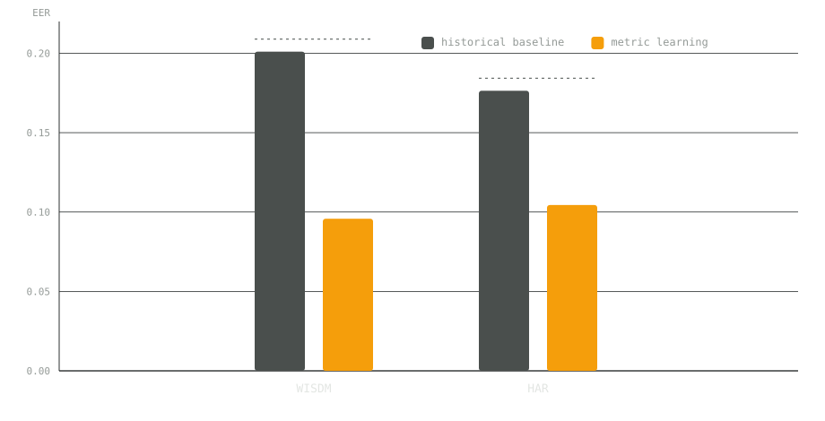
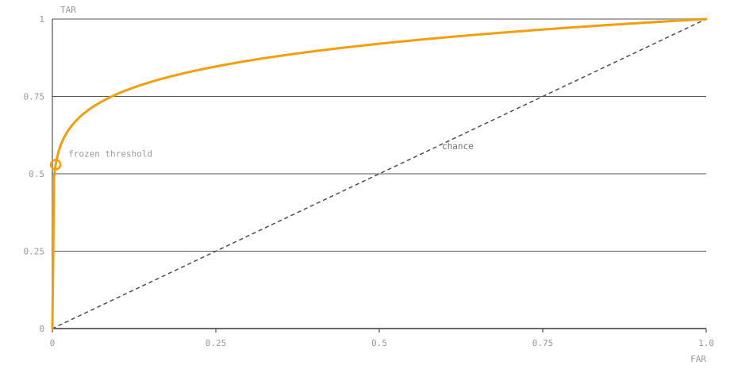
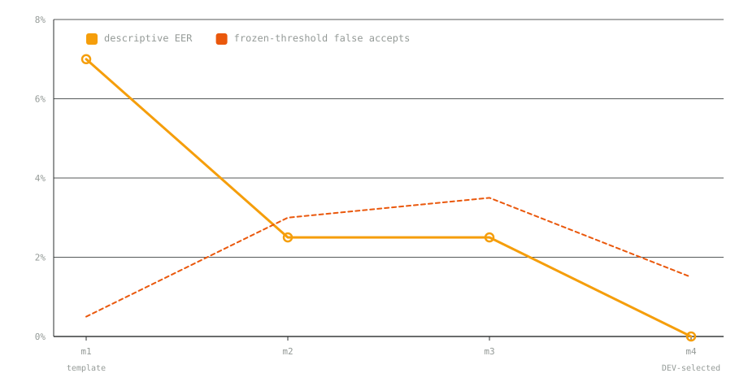
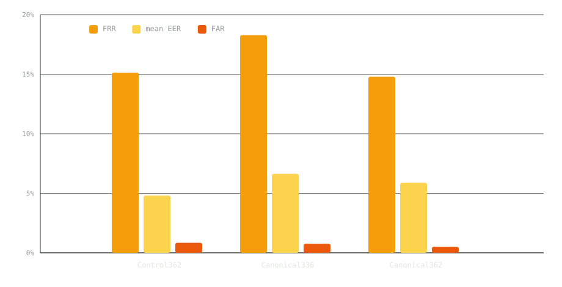
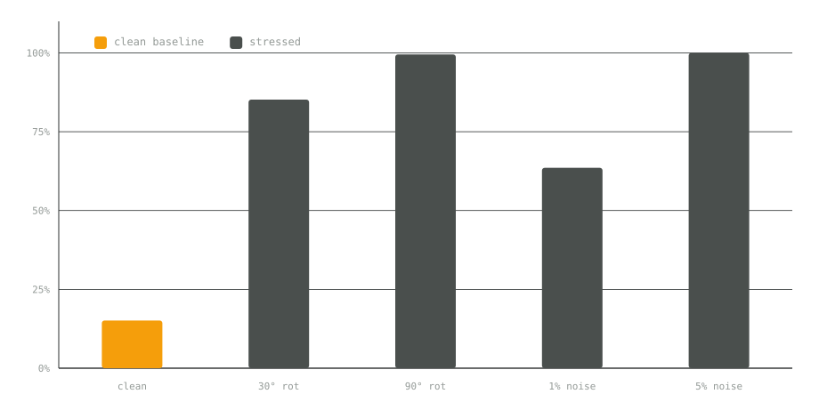
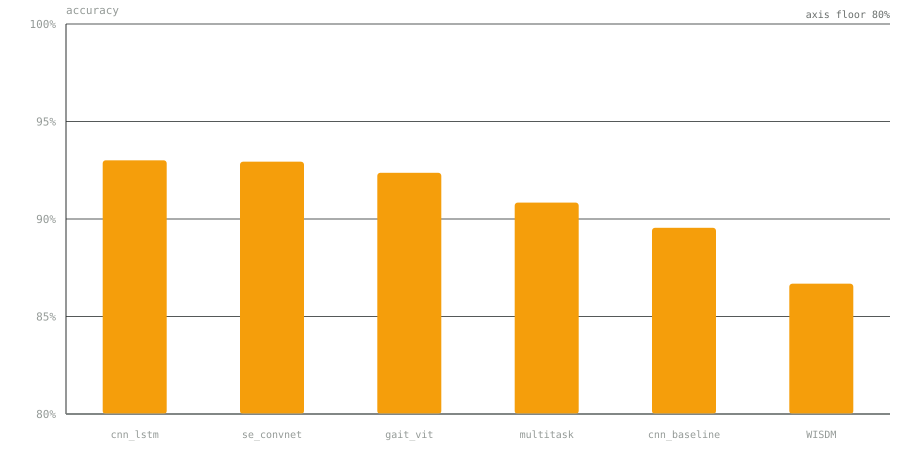
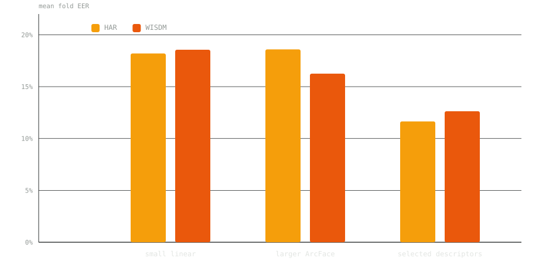
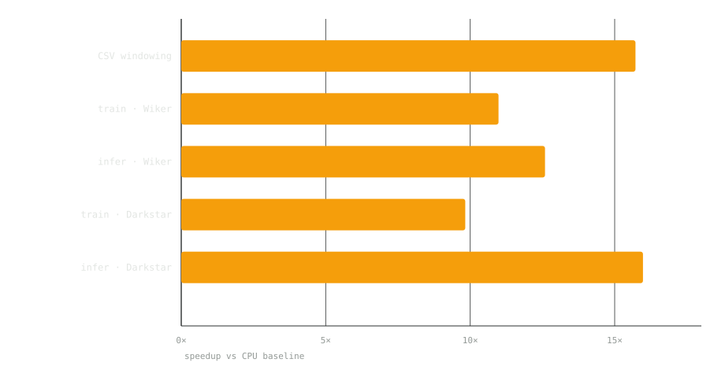

Title: Gait Biometrics
Author: Amaan, Aditya, Nimisha — Minor Specialization Project · MAHE
Theme: gait

# Gait Biometrics

> Notes: Welcome. One minute: the project idea, then the results as graphs, then honest limits.

- Passive user authentication from wearable and smartphone inertial gait signals
- IMU metric-learning baseline with paper-inspired classification and efficiency comparisons
- Built by Amaan (data pipeline), Aditya (deep learning) and Nimisha (evaluation)
- Mentored by Manjunath Hegde · MAHE

---

## The idea in plain English

When you walk, your phone and watch feel the motion through their accelerometers and gyroscopes — tiny sensors that measure how you move. Your stride, your rhythm and your posture all leave a signature in that signal.

Gait authentication is the idea that this signature is personal enough to recognise you: instead of typing a password or pressing a fingerprint, the device just knows it is still you because it recognises how you move.

> Notes: This is the hero paragraph from the site, verbatim.

---

<!-- layout: chart -->

## Metric learning collapsed the equal-error rate

> Notes: WISDM 0.2010 to 0.0958 via multiscale batch-hard ensemble; HAR 0.1764 to 0.1044 via descriptors + covariance normalization. Be honest: the primary HAR neural winner actually worsened to 0.2146, so the descriptor route carried the improvement, not model size. These errors still do not establish usable passive authentication.

---

<!-- layout: chart -->

## Cross-day authentication

> Notes: Santos v7, predeclared 15/5/5 split, day-1 enrollment vs day-2 probes from 5 untouched users. AUC 0.9888, frozen FAR 0.5%, FRR 22%. Small controlled leg-sensor result: only 50 genuine / 200 impostor claims; 8/10 genuine claims for one user rejected — usability limits. Say this out loud.

---

<!-- layout: chart -->

## Four methods, one falling error line

> Notes: m1 historical acceleration + mean template; m2 six-axis axes/invariants + two templates; m3 add lagged covariance; m4 DEV-selected frozen threshold. Frozen false accepts run 1/200 to 6/200 to 7/200 to 3/200 (1.5%); genuine rejections 11/50 to 1/50 to 0/50 to 0/50. At 3/200 the frozen result is not perfect and does not meet the 1% test FAR target.

---

<!-- layout: chart -->

## Canonical orientation across three configurations

> Notes: Under 30/90 degree constant-coordinate rotation its FRR stays 14.787% versus 85.190%/99.500% for the control — orientation-normalisation removes rotation sensitivity, at the cost of a slightly worse clean EER. Folds with FAR above 2%: 3/20 to 3/20 to 2/20.

---

<!-- layout: chart -->

## FRR under stress — the honest weak point

> Notes: Clean threshold stays fixed; stress never selects a winner. This is the honest weak point — orientation/noise fragility.

---

<!-- layout: chart -->

## Activity classification on UCI HAR

> Notes: 2,947 test windows. cnn_lstm (DeepConvLSTM) tops the grid; errors concentrate in SITTING↔STANDING confusion; walking classes are near-clean. WISDM activity_3 is near-perfect at 120/121.

---

<!-- layout: chart -->

## Dev mean fold EER by method

> Notes: Descriptors win on both sources — model size alone does not.

---

<!-- layout: chart -->

## Measured execution gains

> Notes: Execution measurements, separate from biometric quality. Controlled CSV windowing 15.72x vs baseline.

---

<!-- layout: split -->

## Paper → implementation map

- B1 Dehzangi 2017 (Sensors) — multi-sensor fusion CNN
- B2 Chen 2020 (IMWUT) — METIER multi-task activity+user
- B3 Mekruksavanich & Jitpattanakul — DeepConvLSTM continuous auth
- B4 Sheng & Li 2020 (Neurocomputing) — Siamese denoising autoencoders
- B5–B7 — SE-ConvNet, edge gait (pruning/quantization/ONNX), SEGait-ConViT

> Notes: Paper-inspired adaptations, not exact reproductions. Full grid on the site.

---

<!-- layout: timeline -->

## How the work flowed

1. **Phase 1 — Amaan, data pipeline:** UCI HAR + authentic WISDM AR v1.1, restored participant IDs, 128-sample windowing, frozen data/adapter.py contract
2. **Phase 2 — Aditya, deep learning:** all 7 paper tracks (B1–B7), metric-learning extension drove WISDM EER 0.2010 → 0.0958, HAR 0.1764 → 0.1044
3. **Phase 3 — Nimisha, evaluation:** EER/FAR/FRR semantics + ROC, cross-day Santos evaluation, calibration-frozen threshold, robustness tests

> Notes: Two dependencies worth naming: B was blocked on A for WISDM subject IDs; C's finding that the Siamese baseline was unusable (EER 0.4162) fed back into B's metric-learning work.

---

<!-- layout: quote -->

## Where this leaves us

> Passive gait authentication is promising — metric learning and canonical orientation both move the number — but orientation and noise fragility, and small evaluation sets, mean it is not yet usable for real authentication. The honest numbers are the deliverable.